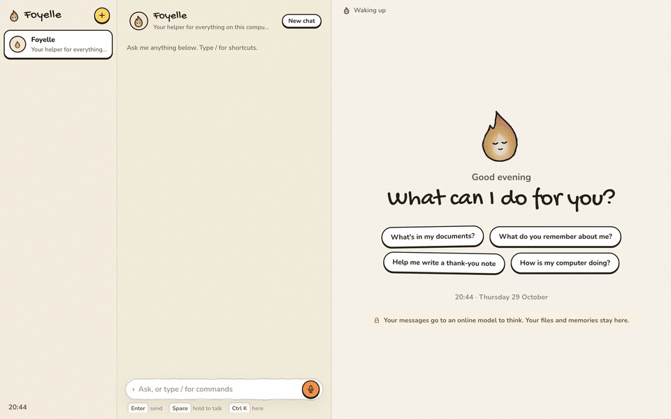

# Foyelle

> [!WARNING]
> **Foyelle is at an early stage and still experimental.** Things break, change or
> disappear without notice. Don't use it with data or accounts you depend on.

Foyelle is an operating system you talk to. It starts straight into one full-screen canvas, with no
windows and no apps: you chat with Foyelle and its bots, and what you need (your files, mail and
calendar, the result of a task) appears as cards on the same canvas. It asks before anything
leaves your home, and every change it makes to the system can be rolled back.

It is built on two open-source projects and an open standard:

- **[Hermes Agent](https://github.com/NousResearch/hermes-agent)**, by Nous Research (MIT), is the
  agent at its core. It already has what Foyelle needs: it connects to any MCP server, works with
  local and online models, and has memory, skills, scheduled tasks and separate profiles, which
  Foyelle uses for its bots. Foyelle keeps its changes as a short series of patches on top of
  Hermes, so it follows Hermes's progress instead of building an agent from scratch.
- **[NixOS](https://nixos.org)** describes the whole system in one configuration. Every change,
  including the ones Foyelle makes for you, builds a new version of the system that you review
  before it is used and can roll back if anything goes wrong. The same configuration always builds
  the same image.
- **[MCP](https://modelcontextprotocol.io)** (Model Context Protocol) is how the agent reaches
  everything else. Each of Foyelle's **helpers** (files, mail, calendar, the web, the system) is an
  MCP server that runs on the machine. A **service** you connect (Todoist, Kiwi.com) is an online
  MCP server, which Foyelle reaches only through a small bridge helper of its own, so Foyelle works
  with the services that already speak MCP instead of needing its own integrations. With
  [MCP Apps](https://modelcontextprotocol.io/docs/extensions/apps), a helper or service also brings
  its own interface: its **cards**, shown on the canvas in a sandbox, where every action goes
  through the same policy as the agent's. Cards take the place of apps; type `/cards`, or ask
  "what cards are there?", to see them all. The [glossary](docs/architecture.md#glossary) has
  these words in one place.

## Why

The way we use computers is changing. We rely more and more on AI assistants and agents, and use
apps and websites directly less and less. Every big tech company now has one: OpenAI's
[ChatGPT](https://chatgpt.com) and its always-on [dots](https://openai.com/index/introducing-dots/),
Anthropic's [Claude](https://claude.ai), xAI's [Grok Bot](https://x.ai/bot), Meta's
[Muse](https://about.fb.com/news/2026/09/introducing-muse-personal-ai-agent/), Google's
[Gemini](https://gemini.google.com), Microsoft's [Copilot](https://copilot.microsoft.com),
Amazon's [Alexa+](https://alexa.amazon.com) and Apple's [Siri](https://www.apple.com/siri/).

The window-based desktop that Apple popularised with the Macintosh in 1984 is ending, and so is the
app-based mobile OS that the iPhone popularised in 2007. Both were built for people who do the work
inside applications; when an assistant does it for them, the user experience has to be rethought
from scratch.

The bot products have made a new shape popular, and their interfaces are converging on it: a list of
bots, a chat you can type or speak to, and a canvas where the results appear. Voice is becoming as
natural a way in as the keyboard. Foyelle follows this direction and makes it the base of the OS
itself, instead of one more app running on top of an old one: you can type to Foyelle or hold the
microphone and talk.

Big tech is building the same thing, inside its own cloud and on its own terms. Foyelle keeps the
person in control and leaves every choice to them. It doesn't have to be all local: they can use a
local model or an online one, and connect Gmail, Google Calendar and other big tech services when
they want to. What Foyelle guarantees is that the choice stays theirs:

- **Control.** The code is open (MIT). Every tool call goes through a policy you can read, actions
  that send, delete or change the computer ask first, and every system change can be rolled back.
- **Privacy.** Your files and memory live on your machine, and so do the tokens of the services you
  connect. Nothing private goes to an online model without your say.
- **Sovereignty.** No vendor account and no lock-in: you own the machine, the data and the
  software, built on NixOS. You pick the model and the services, and can change or drop them.
- **Locality.** With a local model, Foyelle works without an internet connection. Only what needs
  the internet (mail, the web, online services) stops.

## Early days: contributors wanted

Foyelle is at an early stage and still experimental. It runs in a virtual machine on Apple Silicon
Macs, not yet on its own hardware, and much of it is still being tried out. A small team can't build
an operating system alone, so we need contributors. Some places to start:

- **Helpers and cards:** new MCP servers and MCP Apps views for everyday tasks, and more services
  in the directory.
- **Real hardware:** running Foyelle on a PC with the model inside the OS (see
  [where the model runs](docs/architecture.md#6-local-model)).
- **Languages:** Foyelle is meant for people in many countries, so translations, and testing
  dictation and local models in your language.
- **Design and testing:** the canvas and cards, and trying Foyelle with people who aren't
  technical.

The canvas runs on a laptop without a VM; [CONTRIBUTING.md](CONTRIBUTING.md) shows how. Open an
issue or a pull request to get involved.

## Learn more

- [Running Foyelle](docs/running.md): build the image, run it in UTM, and develop against a running VM.
- [Contributing](CONTRIBUTING.md): the repository layout, the canvas without a VM, the Hermes
  patches and the tests.
- [Architecture](docs/architecture.md): how the parts fit together, and where the model runs.
- Features: [bots](docs/bots.md), the [services directory](docs/services-directory.md) and
  [Sign in with Google](docs/google-signin.md).
- [Security](SECURITY.md): how to report a vulnerability privately.
- [Code of conduct](CODE_OF_CONDUCT.md).

## Licence

MIT, the same licence as Hermes (see [LICENSE](LICENSE)); Hermes's code keeps its own MIT notice
([NOTICE](NOTICE)). Contributions are signed off with a DCO ([CONTRIBUTING.md](CONTRIBUTING.md)).
